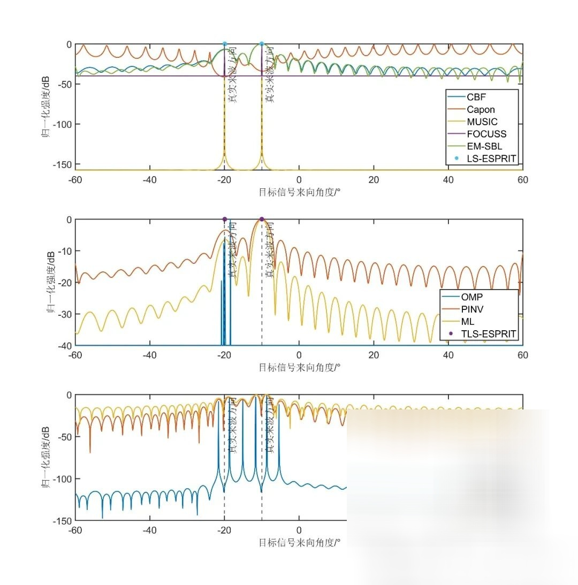

# [DOA Estimation] Overview and Simulation Analysis of MIMO Array Signal DOA Estimation Methods with MATLAB Codes

I. Introduction to Direction Of Arrival (DOA) Estimation
Direction Of Arrival (DOA) estimation plays a crucial role in numerous fields such as radar, communication, electronic reconnaissance, etc. Its core objective is to precisely obtain the angle information of the target or source relative to the antenna array. The combination of multiple-input multiple-output (MIMO) technology and antenna arrays has brought new development opportunities for DOA estimation, significantly enhancing its performance. This paper delves into various DOA estimation methods based on MIMO arrays, covering traditional methods, subspace methods, and sparse recovery methods, and comprehensively analyzes their performance through simulations.
II. Principles of DOA Estimation Methods (Part I)
In MIMO array DOA estimation, the discrete time array signal model is fundamental. Assuming that the source emits a narrow-band far-field signal, with all elements being omnidirectional antennas without mutual coupling and errors, and the phase center is at the leftmost element, its mathematical expression is:
That is, (x = A(\theta)s + n). Here, (x_i(n)) represents the received signal from the ith element at the nth rapid scan; (s_j(n)) represents the transmitted signal from the jth source at the nth rapid scan; (n_i(n)) represents the noise at the ith element; (A(\theta)) is the spatial steering vector matrix, (\theta_j) represents the arrival direction of the jth source, (d) is the element spacing, (\lambda) is the signal wavelength, (M) is the number of elements, and (p) is the number of sources. This model provides a foundational framework for subsequent DOA estimation methods.
2. Capon - Minimum Variance Distortionless Response Method
Capon method introduces the concept of Wiener filtering into spatial processing, also known as the Minimum Variance Distortionless Response (MVDR) method. It ensures that the signal in the desired direction is undistorted by adjusting the weighting coefficients to minimize the array output power, thereby suppressing interference signals from other directions. Its core formula is: where (R_x) is the covariance matrix of the received signals and (a(\theta)) is the steering vector corresponding to the direction (\theta). Compared to CBF, Capon method offers a certain improvement in resolution but its performance can degrade under low signal-to-noise ratio or coherent source conditions.
3. ML - Maximum Likelihood Estimation (ML) is a classic method for parameter estimation. In DOA estimation, it solves the direction of arrival of the source by maximizing the likelihood function of the received signal. Assuming the received signal (x) follows a Gaussian distribution, its likelihood function is: where (R) is the noise covariance matrix. The maximum likelihood function can be used to estimate the direction of arrival (DOA) of the source. ML methods theoretically achieve high estimation accuracy, but they have higher computational complexity, especially in the case of multiple sources, making the solution process very complex.
(III) Subspace Method 1. MUSIC - Multiple Signal Classification (MUSIC) method takes into account the distribution characteristics of signals and noise. It begins by performing a characteristic decomposition on the covariance matrix of the received signal, resulting in the signal subspace and noise subspace. Since the signal subspace is orthogonal to the noise subspace, it leverages this property to construct a spatial spectrum function: where (E_n) is the matrix of feature vectors from the noise subspace. The direction of arrival (DOA) of the source is determined by searching for peaks in the spatial spectrum function. The MUSIC method has high resolution and can effectively distinguish multiple sources, but it is sensitive to the signal-to-noise ratio and array element errors.
2. ESPRIT - Rotational Invariance Subspace Method (Estimation of Signal Parameters via Rotational Invariance Techniques, ESPRIT) utilizes the rotational invariance properties of signal subspace to solve for DOA. It divides the array into two subarrays with overlapping parts, and by establishing a specific rotational relationship between these subarrays, an equation system can be established to estimate the DOA of the source. In simulation implementation, it is common to first process the received signals to obtain the autocorrelation matrix, then use feature decomposition and other operations to obtain the signal subspace, and finally solve for the ESPRIT matrix. The ESPRIT method has high computational efficiency and is suitable for uniform linear arrays, but it requires certain array structure.
(IV) Sparse Recovering Method Based on Compressed Sensing Theory, its core idea is to recover the original signal from a small number of observations using the sparsity of the signal. In DOA estimation, it is assumed that the source is sparsely distributed in spatial angles, meaning only a few directions exist with the source.
1. FOCUSS - Underdetermined System Focusing Method (FOCal Underdetermined System Solver, FOCUSS) focuses on the non-zero components of the signal through iterative optimization. It transforms the problem of solving DOA into an optimization problem, achieving this by minimizing a certain cost function. Its iterative process continuously adjusts the estimated values to make the estimated results closer to the true location of the source, thereby improving the accuracy of DOA estimation.
2. Orthogonal Matching Pursuit (OMP) - Orthogonal Matching Pursuit (OMP) is a commonly used algorithm for sparse signal reconstruction. In DOA estimation, it progressively selects atoms (corresponding to specific angle directions) that are most matched with the observation vectors from the observed data, constructing the sparse representation of the signal. At each iteration, the atom with the largest inner product with the residual is selected, and then the residual is updated until certain stopping conditions are met, thereby determining the DOA of the source.
3. Pseudoinverse Method (PINV) - The Pseudoinverse Method (PINV) solves the sparse representation of signals by computing the pseudoinverse of the observation matrix. In DOA estimation, the product of the pseudoinverse of the steering vector matrix and the received signal is used to estimate the amplitude of the signal at various angles, thereby determining the DOA of the source. This method is computationally relatively simple but may be limited in performance when dealing with noise and coherent sources.
4. Expectation-Maximization Sparse Bayesian Learning (EM-SBL) - The Expectation-Maximization Sparse Bayesian Learning (EM-SBL) method combines the ideas of Maximum Likelihood and Sparse Bayesian Learning. It iteratively optimizes the probability model of the signal and noise through an E-step (expectation step) to calculate the posterior probability, followed by an M-step (maximization step) to update the model parameters, thus achieving the estimation of the DOA of the source. This method has good performance when dealing with sparse signals and can effectively utilize the prior information of the signal.
5. CVX - Convex Optimization Method
III. Simulation Implementation and Results Analysis (I) Simulation Settings In the simulation, a series of adjustable parameters were set, such as carrier frequency, system global sampling rate, signal bandwidth, target bearing angle, number of elements, number of rapid shots, and signal-to-noise ratio. By changing these parameters, different real-world scenarios can be simulated, allowing comprehensive testing of various DOA estimation methods.
(II) Simulation Results 1. Under normal conditions of signal-to-noise ratio and number of frames, different methods exhibit varying performances. The CBF method can roughly determine the direction of the source, but its resolution is limited; the Capon method and ML method improve resolution, enabling more accurate differentiation of the source; subspace methods and sparse recovery methods demonstrate higher resolution, allowing for clear differentiation of multiple sources.
2. In low signal-to-noise ratio (SNR) scenarios, the performance of traditional methods significantly deteriorates as SNR decreases. The estimation precision of CBF and Capon methods is significantly reduced, while the computational complexity of ML methods increases further and their performance is also affected. In subspace methods, MUSIC and ESPRIT methods are sensitive to SNR, leading to increased estimation errors under low SNR conditions. Sparse recovery methods perform well at high SNR but exhibit poor robustness in low SNR situations, resulting in biased estimation outcomes for some methods (such as OMP).
3. For coherent sources, the performance of traditional methods and partial subspace methods is severely degraded, making it impossible to effectively distinguish the source. However, by preprocessing with spatial smoothing filtering followed by subspace or sparse recovery methods, the problem of DOA estimation for coherent sources can be addressed to a certain extent, enhancing estimation accuracy.
4. In cases of few quick shots, the performance of all methods is affected. The estimation accuracy of traditional methods decreases, and the resolution of subspace and sparse recovery methods also reduces. However, relatively speaking, some sparse recovery methods still maintain certain performance in the case of few quick shots, showing certain advantages.
IV. Conclusion This paper provides a detailed introduction to various DOA estimation methods based on MIMO arrays, including traditional methods, subspace methods, and sparse recovery methods, and elaborates on their principles. Through simulation analysis, their performance under different scenarios has been discussed. The CBF in traditional methods is simple and easy to implement but has low resolution; the Capon and ML methods improve resolution to some extent, but they have high computational complexity or are sensitive to signal-to-noise ratio (SNR). Subspace methods such as MUSIC and ESPRIT have higher resolution but are more sensitive to noise and element errors. Sparse recovery methods show unique advantages when dealing with sparse signals, providing high-resolution DOA estimates. However, some methods are not robust in low SNR and few quick shots situations. In practical applications, it is necessary to choose an appropriate DOA estimation method according to specific scene requirements and system conditions to achieve optimal performance. In the future, with the continuous development of technology, DOA estimation methods are expected to achieve further breakthroughs in improving accuracy, reducing computational complexity, and adapting to complex environments.
End

## Images

<!-- PAYMENT_BLOCK -->

## Get this dataset

- Payment link (Stripe): [Buy now](https://buy.stripe.com/3cs8yP7sY87d0vu9AB)
- Payment QR code: 

<!-- /PAYMENT_BLOCK -->
